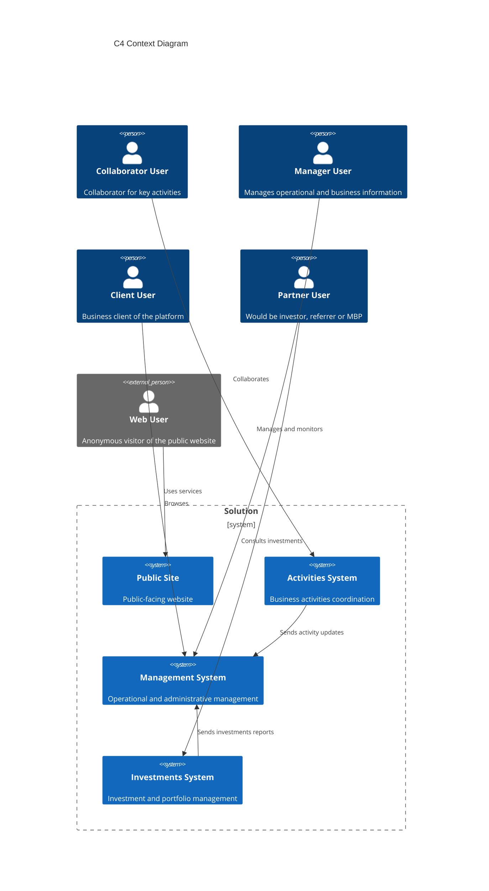
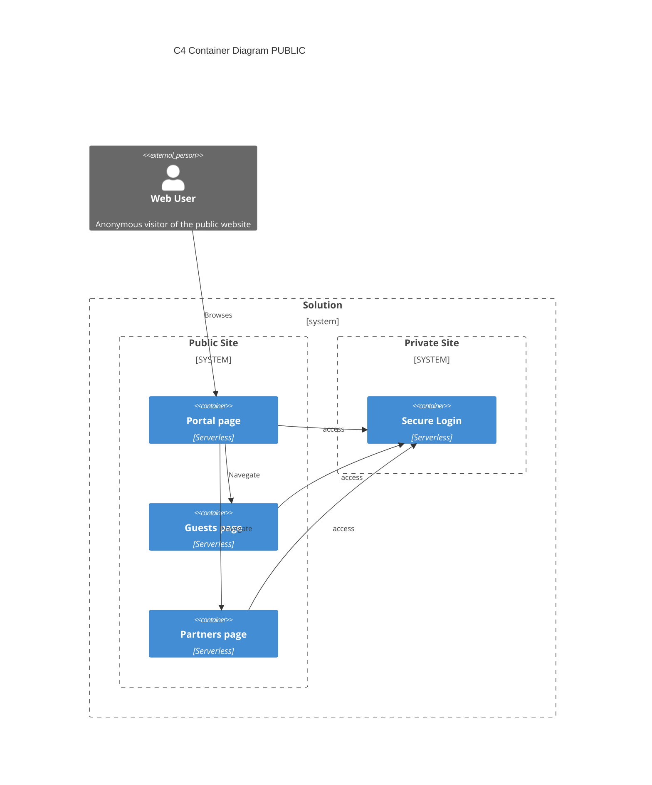

# Architecture Diagrams

## C4 Context diagrams

## C4 Container Diagram · Public Site

## C4 Container Diagram · Activities System

## C4 Container Diagram · Management System

## C4 Container Diagram · Investment System

