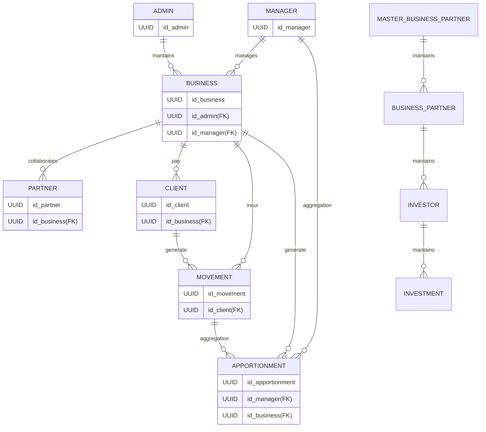
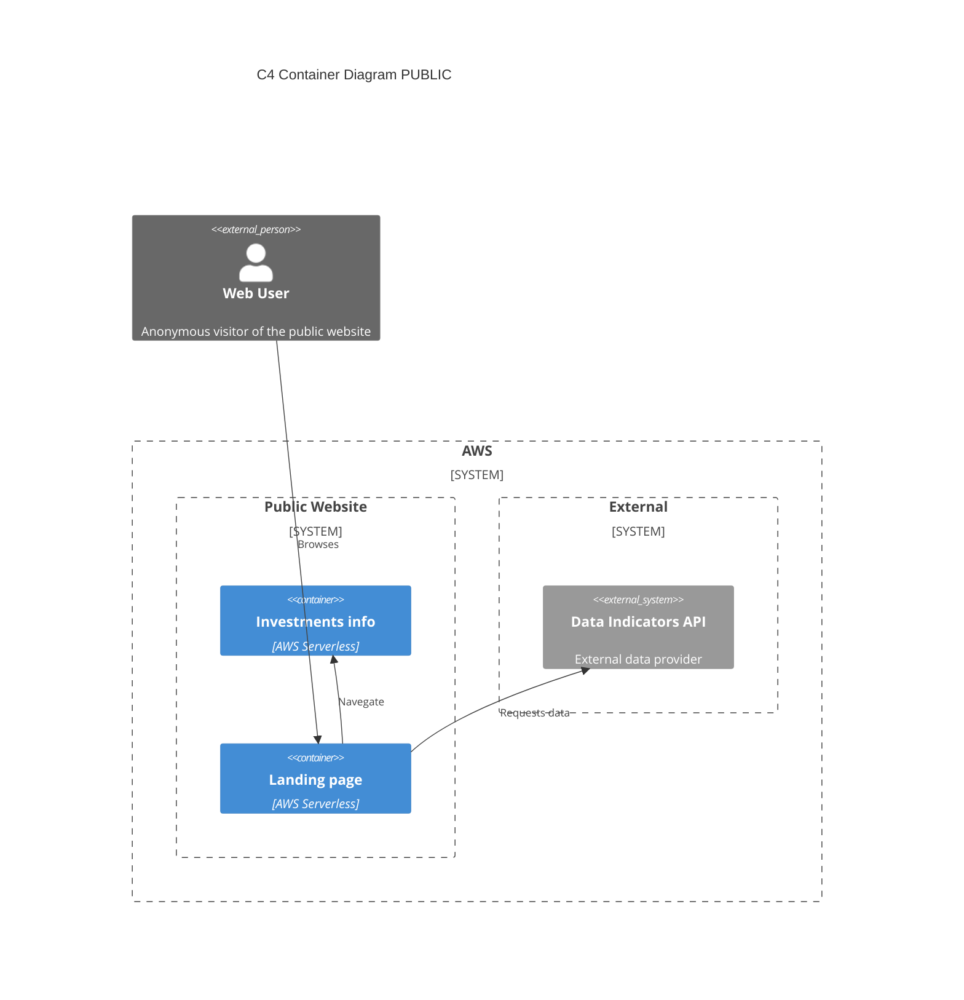

# Architecture Integrated Platform

## I. Modelo Entidad-Relación




## II. C4 model

### Context Diagram (level 1)


### Container Diagram (level 2)

#### PUBLIC



#### PRIVATE

```mermaid

C4Container
    title C4 Container Diagram PRIVATE
    Person(p_partner, "Partner User", "Business partner for key activities")
    Person(p_mgmt, "Management User", "Manages operational and business information")

    Person(p_client, "Client User", "Business client of the platform")
    Person(p_investor, "Investor User", "Capital partner and co-investor")

    System_Boundary(b_system, "AWS") {
        
        System_Boundary(b_management,"Management"){
            
            Container(c_management, "Mobile UI", "AWS Serverless")
            Rel(p_mgmt, c_management, "Manages and monitors")
            Rel(p_client, c_management, "Uses services")
            
            Container(c_clients, "Desktop UI", "AWS Serverless")
            Container(c_mbff, "Mobile BFF", "AWS Serverless")
            Container(c_dbff, "Desktop BFF", "AWS Serverless")
            Container(c_guarantees, "Clients Microservice", "AWS Serverless")
ContainerDb(db_system, "Transactional DB", "AWS Serverless DB")
        }
        System_Boundary(b_investment,"Investment"){
            Container(c_simulations, "Investment simulations", "AWS Serverless")
            Container(c_investment, "Home investment", "AWS Serverless")
            
            Rel(p_investor, c_investment, "Consults investments")
            
        }
        System_Boundary(b_activities,"Activities"){
            Container(c_activities, "Show Activities", "AWS Serverless")
            Rel(p_partner, c_activities, "Collaborates")
            BiRel(c_activities, db_system, "Data Access")
        }

        
        

    }
C4Container
    title C4 Container Diagram PRIVATE

    Person(p_partner, "Partner User", "Business partner for key activities")
    Person(p_mgmt, "Management User", "Manages operational and business information")
    Person(p_client, "Client User", "Business client of the platform")
    Person(p_investor, "Investor User", "Capital partner and co-investor")

    System_Boundary(b_system, "AWS") {
        
        System(sys_activities, "Activities System", "Business activities coordination")
        Rel(p_partner, sys_activities, "Collaborates")
        Rel(sys_activities, sys_management, "Sends activity updates")

        System(sys_management, "Management System", "Operational and administrative management")
        Rel(p_client, sys_management, "Uses services")
        Rel(p_mgmt, sys_management, "Manages and monitors")

        System(sys_investments, "Investments System", "Investment and portfolio management")
        Rel(p_investor, sys_investments, "Consults investments")
        Rel(sys_investments, sys_management, "Sends investments reports")

        System_Boundary(b_activities,"Activities System"){
            Container(c_activities, "Show Activities", "AWS Serverless")
            Container(c_activities_admin, "Activities management", "AWS Serverless")
            
        }
        System_Boundary(b_management,"Management System"){
            Container(c_management, "Home management", "AWS Serverless")
            Container(c_clients, "Clients management", "AWS Serverless")
            Container(c_movement, "Movements management", "AWS Serverless")
            Container(c_guarantees, "Guarantees management", "AWS Serverless")
        }

        System_Boundary(b_investment,"Investment System"){
            Container(c_investment, "Home investment", "AWS Serverless")
            
        }

    }


```
